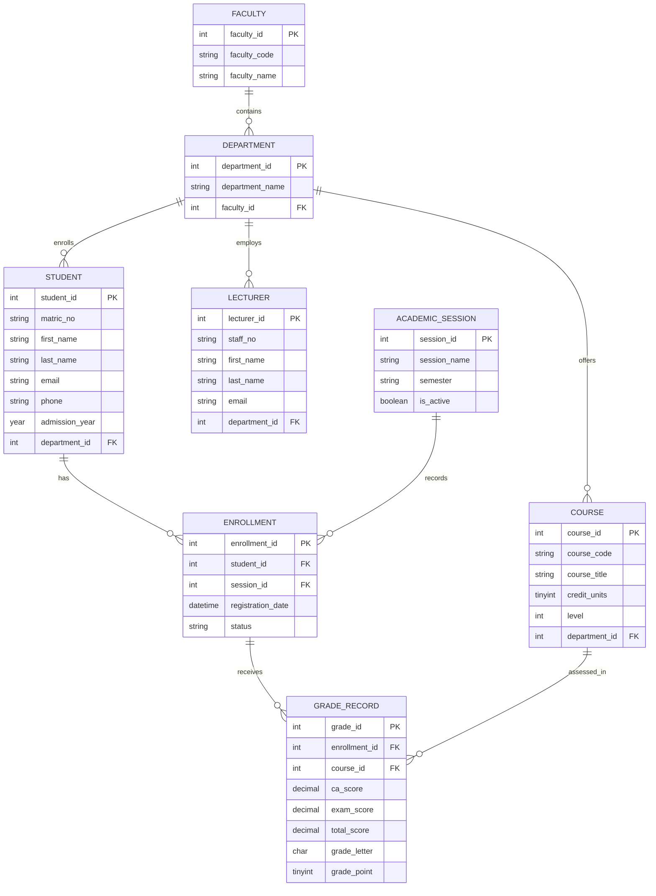

# Portfolio 1: Database Design and Modelling

## Chosen Case Study Description
The selected case study is the University of Lagos (UNILAG) – Academic Records and Result Management Portal. This relational database system is designed to manage the core academic administration processes of a university. It tracks hierarchical institutional structures (Faculties and Departments), manages student enrollment data across academic sessions, assigns lecturers, and maintains a comprehensive course catalog. Crucially, the system records student academic performance, enforcing constraints on Continuous Assessment (CA) and Examination scores, and automatically computes total grades to facilitate transcript generation.

## Normalisation Explanation (to 3NF)
The database schema has been meticulously designed and normalized up to the Third Normal Form (3NF) to ensure data integrity and eliminate redundancy:
* **First Normal Form (1NF):** All tables have a defined primary key (e.g., `student_id`, `course_id`). All attributes contain atomic, indivisible values (e.g., `first_name` and `last_name` are separate columns). There are no repeating groups.
* **Second Normal Form (2NF):** The schema meets 1NF, and all non-key attributes are fully functionally dependent on the primary key. 
* **Third Normal Form (3NF):** The schema meets 2NF, and there are no transitive dependencies. Non-key attributes depend *only* on the primary key. For instance, the `ENROLLMENT` table links `student_id` and `session_id` as foreign keys rather than storing redundant student or session details directly.

## Entity-Relationship (ER) Diagram

